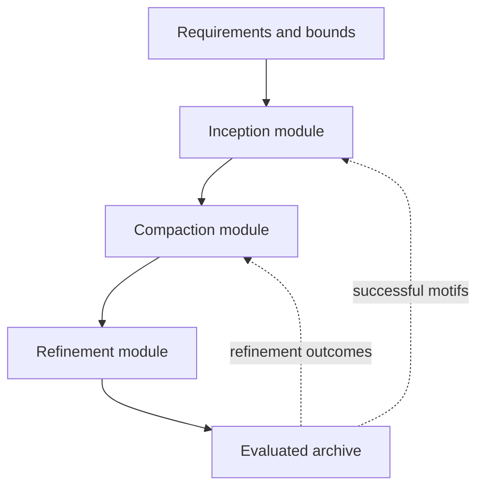

# Future directions: automated discovery, compaction, and refinement of freeform optical systems

## Purpose

This document consolidates the future research directions discussed in the Optics project. The central proposal is an automated framework that does more than vary a known three-mirror fold:

> **It proposes bounded optical geometries, discovers or creates new ray–surface interaction sequences, compacts those geometries by introducing useful folds, and automatically refines the resulting systems.**

The proposed framework has three modules:

1. **Inception:** propose a ray path and bounded seed geometry.
2. **Compaction:** reduce package size and increase useful folding without destroying optical feasibility.
3. **Refinement:** convert a viable folded system into a high-performance prescription.

This was written as a prospective research plan. A first spherical-only implementation
of Inception → sequence-preserving Compaction now exists; see
`04_spherical_inception_compaction_20260904.md`. That implementation does **not** yet
constitute a strongly dissimilar hardened discovery: its conservative 3-edit/35% run
promoted zero candidates, while the completed compaction example is explicitly labeled
a lower-bound/prefix-extension demonstrator.

---

## 1. The research gap

The previously reviewed methods automate substantial parts of freeform design, but they retain strong structural assumptions:

- Yang 2017 and Wu 2020 begin from a supplied planar folding geometry.
- Bauer 2018 and Papa 2019 reason about structured families of starting geometries using aberration theory.
- Zhang 2021 searches optical-power distributions (P) and chief-ray folding vectors (C), but retains the sequential interaction order object → M1 → M2 → M3 → image.
- Chen 2021, FreeformNet, ODMINN, and the cGAN learn within system and folding representations already encoded in their training processes.
- Differentiable-ray-tracing and GA approaches still require a parameterized optical architecture on which to operate.

The missing category is:

> **Automated discovery of the interaction structure itself—particularly paths containing repeated, non-monotonic, or otherwise nontraditional surface encounters—followed by automatic packaging and optical refinement.**

Examples of interaction sequences that a more general framework might discover include

\[
M_1\rightarrow M_3\rightarrow M_1\rightarrow M_2\rightarrow I
\]

or

\[
M_1\rightarrow M_2\rightarrow M_3\rightarrow M_2\rightarrow I,
\]

provided that the repeated contacts are intentional, physically separated on the surfaces, manufacturable, and useful to imaging.

The key distinction is not merely “more folding geometries.” It is the difference between:

\[
\text{continuous variation of a known sequence}
\]

and

\[
\text{search over both geometry and the induced interaction sequence}.
\]

---

## 2. Current project position

### Capabilities already discussed

- A CMA-based generation environment can produce unusual folded geometries and ray paths.
- A quality-diversity archive indexes candidates using at least:
  - packing/compactness; and
  - number of folds or surface interactions.
- The archive has revealed some interesting and potentially novel interaction sequences.
- A robust translation path from the internal environment into CODE V has been developed.
- A preliminary refinement loop exists and has shown some improvement in translated systems.

### Current limitations

1. **Spurious ray–surface interactions.** Many novel paths contain accidental contacts rather than intentional optical interactions.
2. **Sparse successful archive.** Only a small number of strong solutions have been produced so far.
3. **Wide-field uncertainty.** Some systems focus the sampled rays but may not scale to a useful field of view.
4. **Restricted surface model.** The current spherical parameterization may be responsible for part of the wide-field limitation.
5. **Refinement instability.** The existing refinement loop is useful but not yet systematic, modular, or demonstrably convergent.
6. **Sequence ambiguity.** Counting interactions alone does not distinguish useful folds from repeated accidental hits, grazing contacts, or unstable paths.
7. **Archive semantics.** Packing and fold count encourage structural novelty, but do not fully describe optical behavior or refinability.

These limitations motivate the separation into Inception, Compaction, and Refinement modules.

---

## 3. Proposed three-module framework



The modules should communicate through explicit records rather than through one opaque optimizer state. A candidate should remain inspectable before and after every transformation.

### Minimal shared candidate record

```text
candidate_id
parent_ids and generating operation
system requirements
surface inventory and surface parameterization
bounded spatial geometry
intended interaction sequence, if proposed explicitly
observed interaction sequence for every traced ray
ray bundles by field and wavelength
validity and obstruction flags
package/packing descriptors
pre-refinement optical metrics
refinement trajectory
post-refinement optical metrics
manufacturing and tolerance descriptors
random seed and software provenance
```

---

## 4. Module I — Inception

### Objective

Generate diverse, bounded, ray-traceable seed systems whose interaction structures are not limited to a fixed zig-zag or M1 → M2 → M3 template.

### Two complementary discovery modes

#### A. Geometry-first discovery

1. Place bounded surfaces or surface-support regions inside a permitted volume.
2. Sample the entrance-ray bundle.
3. Perform non-sequential ray tracing.
4. Read the interaction sequence from the resulting ray history.
5. Retain candidates whose rays exhibit coherent, intentional-looking sequences.

This mode permits unexpected sequences to emerge because the geometry—not a predefined sequential model—determines what gets hit.

#### B. Sequence-first discovery

1. Propose a symbolic interaction sequence or interaction graph.
2. Assign surface identities, repeated-contact constraints, and approximate chief-ray directions.
3. Solve for a bounded geometry that realizes the proposed sequence.
4. Verify it through non-sequential tracing.

This mode allows explicit exploration of rare sequence motifs but requires a grammar that prevents impossible proposals.

The strongest framework may use both modes: geometry-first search discovers motifs, and sequence-first search deliberately resamples or extends successful motifs.

### Proposed sequence representation

A sequence record should contain more than mirror labels:

\[
S=\bigl[(m_i,\,p_i,\,\hat d_i,\,a_i,\,r_i)\bigr]_{i=1}^{L},
\]

where, for interaction (i):

- (m_i) is the surface identity;
- (p_i) is the contact point or surface region;
- (\hat d_i) is the incident/outgoing direction descriptor;
- (a_i) is incidence angle or another conditioning descriptor; and
- (r_i) identifies whether the contact is the first or a repeated use of that surface.

This distinguishes two candidates that share the same label string but use different regions, angles, or path geometry.

### Inception feasibility gates

A seed should pass inexpensive tests before entering compaction:

- most required rays complete the intended path;
- field rays share a stable sequence, or sequence branching is explicitly allowed;
- repeated contacts occur on separated usable surface regions;
- incidence angles remain within chosen limits;
- no path segment is numerically degenerate;
- the path reaches an image-side region with a plausible conjugate;
- paraxial or finite-ray optical power is nonzero and appropriately signed;
- minimum clearances are satisfied; and
- the design is not merely a duplicate under rigid motion, mirroring, or surface relabeling.

### Distinguishing intentional and spurious contacts

This is the first major research problem. A contact should not count as a meaningful fold solely because one chief ray touches a surface.

Possible criteria include:

1. **Bundle support:** a required fraction of pupil and field rays undergo the contact.
2. **Sequence persistence:** the interaction survives small perturbations to rays and geometry.
3. **Spatial coherence:** contact points occupy a compact, usable footprint rather than scattered accidental locations.
4. **Angular margin:** the contact is not a near-tangent numerical event unless grazing incidence is intended.
5. **Functional contribution:** removing or flattening the interaction measurably worsens focus, packaging, or another objective.
6. **Clearance margin:** the path has positive separation from unintended surfaces before and after the event.

A useful output label is therefore not just `hit` but

```text
intentional / spurious / ambiguous / field-dependent / unstable
```

### Inception objectives and archive descriptors

The existing packing × fold-count archive is a strong starting point. Additional descriptors worth testing are:

- interaction-sequence hash or edit-distance cluster;
- number of unique surfaces versus total interactions;
- number of repeated-surface interactions;
- path-length ratio to bounding-box diagonal;
- number of direction reversals;
- intermediate-image count;
- pupil relocation or stop-conjugate behavior;
- chief-ray turning-angle signature;
- beam-footprint separation on reused surfaces;
- field-sequence consistency;
- approximate optical-power distribution; and
- estimated refinement potential.

The archive should avoid using too many simultaneous axes. A practical strategy is to maintain several complementary archives or a learned latent descriptor in addition to a small interpretable archive.

---

## 5. Module II — Compaction

### Objective

Transform a valid but spacious optical path into a smaller packaged system while preserving its imaging function and interaction identity.

Compaction is not equivalent to minimizing bounding-box volume. A smaller system that loses fields, develops obscuration, merges footprints, or creates unintended contacts is not a successful compact design.

### Core transformation types

1. Translate and rotate surfaces while retaining the current sequence.
2. Introduce a new fold using an existing powered surface.
3. Introduce or remove a planar folding surface when allowed by the design brief.
4. Reuse a powered surface at a distinct footprint.
5. Shorten free-space segments while rebalancing optical power.
6. Relocate the aperture stop or an intermediate pupil if the system representation permits it.
7. Merge mechanically compatible surfaces onto a common substrate.

### Multi-objective compaction problem

A candidate compaction objective can be written schematically as

\[
J_{\mathrm{compact}}=
w_VV+w_LL_{\mathrm{path}}+w_OO+w_CC+w_SS-w_MM,
\]

where:

- (V) is envelope volume;
- (L_{\mathrm{path}}) is total path length or excess path length;
- (O) is obscuration/vignetting penalty;
- (C) is clearance/interference penalty;
- (S) is sequence-instability penalty; and
- (M) rewards desired sequence motifs or fold additions.

Optical feasibility should usually be a constraint or feasibility tier, not a weakly weighted term that volume minimization can overwhelm.

### Sequence-preserving versus sequence-changing compaction

The module should support two operating modes:

- **Sequence-preserving:** reduce size while every required field maintains the same interaction sequence.
- **Sequence-changing:** permit a new intentional fold or repeated contact, then revalidate the complete path.

The first mode is easier to interpret and should be the initial implementation. The second is more novel and can be introduced once interaction validation is reliable.

### Robustness tests during compaction

Each accepted step should be tested against:

- small geometric perturbations;
- denser pupil sampling;
- additional field points;
- wavelength variation when relevant;
- finite surface apertures;
- minimum mechanical thickness and separation; and
- footprint overlap on reused mirrors.

### Useful compaction trajectory data

Store every accepted and rejected transformation:

```text
parent geometry
proposed transformation
new sequence
volume change
clearance change
optical-metric change
feasibility outcome
rejection reason
```

This can later train a model that predicts which geometric operation will compact a system without destroying it.

---

## 6. Module III — Refinement

### Objective

Convert a viable compact geometry into a wide-field, high-performance, manufacturable freeform optical system without losing its discovered interaction structure.

### Proposed staged refinement

#### Stage 0 — translation and validation

- Translate the candidate into CODE V or another trusted sequential/non-sequential representation.
- Reproduce surface locations, orientations, apertures, ray directions, and coordinate breaks.
- Confirm that the external model reproduces the internal ray histories and first-order quantities.

The existing robust environment-to-CODE V translator is a major asset here. Translation validation should be treated as a testable module, not an assumed step.

#### Stage 1 — restore basic imaging

- Optimize image-plane position and tilt.
- Adjust a small number of powered-surface parameters.
- Use sparse field/pupil sampling.
- Penalize ray loss, sequence changes, obscuration, and invalid intersections strongly.

#### Stage 2 — introduce freeform degrees of freedom

- Begin with low-order freeform terms or a low-dimensional surface basis.
- Add terms gradually based on residual aberration structure or sensitivity.
- Optimize surface coefficients together with selected geometric variables.
- Preserve footprint separation and clear apertures.

#### Stage 3 — expand field, pupil, and spectrum

- Use curriculum refinement: start with a small field and gradually increase to the requested FOV.
- Increase pupil-ray density.
- Add wavelengths and chromatic constraints for refractive/catadioptric systems.
- Recheck the interaction sequence at every curriculum stage.

This directly tests whether current narrow-field successes were limited by the spherical representation or are intrinsically non-scalable.

#### Stage 4 — packaging and manufacturability

- Constrain freeform departure, slope, curvature, and sag.
- Add mirror-edge, mount, substrate, and tool-access constraints.
- Evaluate tolerances and alignment sensitivity.
- Perform a final compaction–refinement alternation if packaging constraints degrade performance.

### Refinement merit hierarchy

A lexicographic or tiered merit system is preferable to one undifferentiated weighted sum:

1. **Validity:** rays complete the required path.
2. **Sequence integrity:** intended interactions remain stable across field and pupil.
3. **No obscuration/interference:** clearances and apertures are valid.
4. **First-order compliance:** EFL, F/#, conjugates, pupil, and image size.
5. **Image quality:** spot, WFE, MTF, distortion, telecentricity as required.
6. **Packaging:** volume, shape, path length, fold count.
7. **Manufacturability:** departure, slope, curvature, tolerance sensitivity.

This ordering prevents an optimizer from achieving a small spot for a tiny surviving subset of rays while silently invalidating the intended system.

### Refinement feasibility prediction

An important future model is

\[
f(x_0,B)\rightarrow
\bigl[p(\text{successful refinement}),\ \hat q_B,\ \hat c_B\bigr],
\]

where (x_0) is the unrefined candidate, (B) is a fixed optimization budget, (\hat q_B) is predicted final quality, and (\hat c_B) is predicted cost.

Potential inputs include:

- initial spot/WFE/distortion;
- field-dependent aberration descriptors;
- first- and higher-order sensitivity information;
- missing-ray and obstruction margins;
- sequence stability;
- power distribution;
- footprint geometry;
- parameter Jacobian rank/conditioning;
- package constraints; and
- archive descriptors.

The training target must come from actually applying the same refinement policy and budget to many candidates. Otherwise “refinability” is not defined consistently.

---

## 7. The archive as a scientific instrument

The archive should retain failures and trajectories, not only final elites. Its purpose is both optimization and study of the discovered design space.

### Recommended record families

#### A. Raw inception candidates

Include valid and invalid geometries, observed sequences, contact footprints, and precise failure labels.

#### B. Compaction transitions

Store parent → operation → child tuples, including rejected transformations.

#### C. Refinement pairs

Store

\[
(\text{pre-refinement candidate},\ \text{post-refinement result},\ \text{budget}).
\]

#### D. Complete optimization trajectories

Record intermediate prescriptions, merit components, constraint violations, optimizer events, and stopping reasons.

#### E. Counterfactual variants

For a successful system, intentionally remove a fold, change one interaction, alter a surface basis, or perturb packaging to measure which structures are causally important.

### Negative examples are essential

Useful negative categories include:

- no image-forming path;
- ray-tracing failure;
- field-dependent sequence collapse;
- accidental extra contact;
- grazing/tangent instability;
- obscuration;
- insufficient clear aperture;
- impossible mechanical overlap;
- optimizer divergence;
- good on-axis focus but poor wide-field scaling;
- correctable but too expensive under the budget; and
- compact but unmanufacturable.

A model trained only on successful prescriptions would learn the appearance of existing successes, but not the boundaries separating intentional folds from pathological ray histories.

---

## 8. Open-source model and fine-tuning direction

The earlier idea of fine-tuning an open model remains viable, but the model target should be chosen after the data structure is understood.

### Candidate learning tasks, ordered from lowest to highest risk

1. **Failure classifier:** detect spurious contacts, ray loss, or unlikely refinement success.
2. **Refinement-value model:** rank candidates by expected improvement under a fixed budget.
3. **Compaction-operation policy:** propose the next safe geometric transformation.
4. **Archive retrieval model:** retrieve structurally similar successful motifs for a new specification.
5. **Conditional prescription generator:** generate continuous geometry/surface parameters within a known sequence family.
6. **Interaction-sequence generator:** propose a sequence or interaction graph conditioned on specifications and bounds.
7. **End-to-end optical agent:** alternate generation, simulation, compaction, and refinement using tool feedback.

The first useful model probably should not be a large language model trained directly to emit full prescriptions. A smaller structured model can first learn feasibility, refinement value, or geometric actions from well-defined numerical records. An LLM can later coordinate tools, explain decisions, retrieve precedents, and propose symbolic sequence motifs.

### Possible representations

- Tokenized interaction sequence plus continuous geometry vector.
- Graph neural network over surfaces and ray-segment interactions.
- Set/transformer representation of surfaces and field-ray histories.
- Voxel or signed-distance representation of the permitted package volume.
- Hybrid symbolic–continuous representation: sequence grammar + differentiable surface/pose parameters.

### Data quantity strategy

Because only a few strong systems currently exist, the immediate goal should be **dense, informative trajectory data**, not an arbitrary target count of final designs. One failed refinement run with complete diagnostics may be more useful than many nearly identical final prescriptions.

Active learning can prioritize candidates for expensive refinement when the feasibility model is uncertain or when a candidate occupies a rare archive niche.

---

## 9. Research hypotheses

The program can be organized around falsifiable hypotheses:

### H1 — emergent-sequence hypothesis

Non-sequential bounded-geometry search can discover stable interaction sequences absent from a predefined catalogue.

### H2 — diversity-value hypothesis

An archive indexed by sequence and packaging descriptors finds more structurally distinct viable systems than single-objective CMA or random search at equal ray-tracing budget.

### H3 — intentional-contact hypothesis

Bundle-level stability and footprint-coherence tests can distinguish useful repeated interactions from spurious contacts with high precision.

### H4 — modularity hypothesis

Separating inception, compaction, and refinement yields a higher success rate than optimizing optical quality and volume simultaneously from random geometries.

### H5 — curriculum-refinement hypothesis

Gradually expanding field, pupil, and surface order converts more narrow-field seeds into wide-field systems than optimizing the full specification from the start.

### H6 — trajectory-learning hypothesis

A predictor trained on pre/post-refinement pairs can reduce expensive refinement calls without suppressing rare but highly correctable designs.

### H7 — freeform-rescue hypothesis

Some candidates that appear non-scalable with spherical surfaces become viable after controlled low-to-high-order freeform introduction.

---

## 10. Evaluation plan

### Baselines

Compare against:

1. random bounded-geometry search;
2. single-objective CMA optimization;
3. quality-diversity CMA using only packing and fold count;
4. a fixed sequential three-mirror (P\times C)-style search;
5. fixed-fold parameter optimization followed by the same refinement budget; and
6. ablated versions of each proposed module.

The comparison need not reproduce every external paper’s software. It should reproduce the structural restriction relevant to the hypothesis: fixed sequence, fixed fold family, or no archive diversity.

### Discovery metrics

- number of ray-traceable candidates;
- number of unique stable sequences;
- sequence-cluster coverage;
- fraction of intentional versus spurious contacts;
- field/pupil sequence consistency;
- novelty relative to known fold families; and
- compute per distinct viable sequence.

### Compaction metrics

- envelope volume and dimensions;
- path length;
- folds or intentional interactions added;
- clearance and footprint margins;
- fraction of candidates retaining sequence integrity; and
- optical degradation caused by compaction.

### Refinement metrics

- success rate under a fixed budget;
- time/evaluations to reach thresholds;
- WFE, spot, MTF, distortion, and throughput;
- final usable FOV;
- obstruction and missing-ray rate;
- freeform departure/slope/curvature; and
- tolerance or sensitivity measures.

### End-to-end metrics

- viable refined systems per unit compute;
- diversity of final interaction sequences;
- Pareto coverage over image quality, package size, and manufacturability;
- percentage translated faithfully into CODE V;
- human interventions per successful design; and
- reproducibility across random seeds.

---

## 11. Essential ablations

1. Packing × fold-count archive versus packing × sequence descriptor.
2. Chief-ray-only interaction validation versus full bundle validation.
3. No spurious-contact filter versus persistence/footprint filtering.
4. One monolithic optimizer versus three modules.
5. Sequence-preserving compaction versus sequence-changing compaction.
6. Spherical-only refinement versus staged freeform introduction.
7. Full-FOV optimization from the start versus curriculum FOV expansion.
8. Handwritten refinement priority versus learned refinement-value ranking.
9. Retaining failures/trajectories versus training on final elites only.
10. Geometry-first versus sequence-first inception.

---

## 12. Proposed staged roadmap

### Phase A — make interaction discovery trustworthy

- Define canonical ray-history and interaction-sequence representations.
- Implement bundle-level sequence-consistency checks.
- Label spurious, grazing, unstable, and field-dependent contacts.
- Deduplicate sequences under relabeling, reflection, and rigid transformations.
- Re-evaluate the existing CMA archive using the new labels.

**Exit criterion:** the framework can reliably state what sequence a candidate implements and why each counted contact is intentional.

### Phase B — stabilize refinement

- Formalize the CODE V translation validation tests.
- Define a fixed refinement budget and tiered merit function.
- Add curriculum field/pupil expansion.
- Introduce low-order freeforms progressively.
- Store complete pre/post-refinement pairs and trajectories.

**Exit criterion:** refinement success and failure are reproducible enough to become training labels.

### Phase C — sequence-preserving compaction

- Optimize package metrics while constraining sequence integrity.
- Store accepted/rejected compaction transformations.
- Measure how compactness affects refinement success.

**Exit criterion:** the same viable sequence can be made materially smaller with bounded optical degradation.

### Phase D — sequence-changing compaction

- Allow intentional addition of folds or repeated-surface contacts.
- Apply the interaction-validity machinery after every change.
- Compare discovered paths with the existing archive and known fold families.

**Exit criterion:** new interactions improve packaging or optical function and remain stable across the full ray bundle.

### Phase E — learned screening and proposal

- Train the failure and refinement-value models first.
- Add active learning for expensive refinement allocation.
- Train a compaction-operation policy.
- Only then attempt conditional sequence generation or end-to-end model coordination.

**Exit criterion:** learned components improve yield or compute efficiency on held-out requirements without collapsing archive diversity.

---

## 13. Novelty framing for a paper

Avoid claiming that this is the first automated framework to generate folded freeform designs. Prior work already searches or learns multiple folds.

A defensible novelty statement is:

> Existing automated freeform-design frameworks predominantly optimize within a supplied interaction order, a parameterized folding family, or a finite taxonomy of folds. We investigate a modular framework in which bounded non-sequential geometry gives rise to the ray–surface interaction sequence itself, including repeated surface use, after which dedicated compaction and refinement stages transform viable paths into packaged optical systems.

Potential contributions are:

1. a representation for emergent freeform interaction sequences;
2. a bundle-level test for intentional versus spurious contacts;
3. a quality-diversity search over sequence and packaging behavior;
4. a sequence-aware compaction operator or module;
5. a reproducible automatic refinement protocol linked to CODE V;
6. an archive containing failures, trajectories, and pre/post-refinement pairs; and
7. evidence that the modular pipeline discovers viable structures outside predefined fold families.

The strongest claim will come from demonstrated systems and controlled baselines, not from the architecture diagram alone.

---

## 14. Highest-priority next experiments

1. **Audit the existing archive.** Re-trace every candidate with dense field/pupil bundles and label every interaction as intentional, spurious, ambiguous, or unstable.
2. **Create a canonical sequence fingerprint.** Include surface identity, repeat index, footprint region, and turning-angle information.
3. **Define one fixed refinement protocol.** Use the same merit hierarchy, variables, budget, and stopping criteria for every candidate.
4. **Test spherical versus staged freeform refinement.** Determine whether wide-FOV failure comes from the seed topology or the surface basis.
5. **Build the first pre/post-refinement dataset.** Include failures and full trajectories.
6. **Compare archives.** Packing × folds versus packing × sequence novelty versus a hybrid descriptor.
7. **Implement sequence-preserving compaction.** Treat intentional sequence and clearance as hard constraints.
8. **Train a simple refinement-value baseline.** Start with gradient-boosted trees or a small structured network before attempting a generative foundation model.

These experiments convert the project’s current assets into evidence for or against the central thesis while also producing the data required for later learned modules.

---

## 15. Long-term vision

The eventual system would accept optical requirements and packaging bounds, then return a diverse, ranked set of manufacturable systems together with their provenance:

\[
\boxed{
\text{requirements}
\rightarrow
\text{new interaction sequences}
\rightarrow
\text{compact embodiments}
\rightarrow
\text{refined freeform prescriptions}
}
\]

Each result would include:

- the discovered sequence and why its contacts are intentional;
- its archive niche and nearest known alternatives;
- the inception and compaction history;
- pre- and post-refinement performance;
- sensitivity and manufacturing estimates;
- the complete external optical-software prescription; and
- enough provenance to reproduce the result.

The broader goal is not simply a faster prescription generator. It is a system capable of **structural optical invention**, followed by the engineering discipline required to determine which inventions are real, refinable, compact, and buildable.
